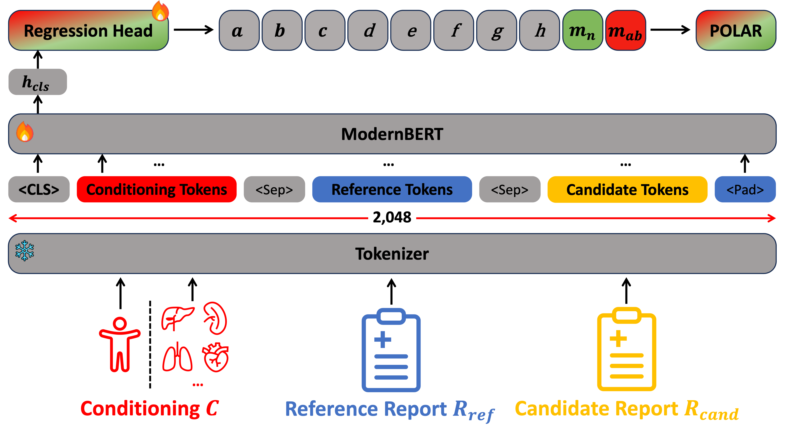

<div align="center">

# POLAR: Polarity-Aware and Anatomy-Conditioned Radiology Report Evaluation

**Lukas Buess, Tri-Thien Nguyen, Xiaoliang Wang, Paula Andrea Perez-Toro, Tomas Arias-Vergara, Bernhard Kainz, Andreas Maier**

EMNLP 2026

[](https://aclanthology.org/2026.emnlp-main.2675/)
[](https://huggingface.co/lbuess/POLAR)
[](https://huggingface.co/datasets/lbuess/POLAR-Synth)
[](LICENSE)

</div>

<p align="center">
  
</p>

POLAR scores a **candidate** radiology report against a **reference** report. A Bio-ModernBERT-large encoder predicts how many clinically significant errors the candidate contains and how many normal and abnormal findings it matches. It then combines these counts into one score in [−1, 1]. The score can cover the full report or a single anatomy.

## News

- **2026-11**: Code, model weights ([lbuess/POLAR](https://huggingface.co/lbuess/POLAR)) and the POLAR-Synth dataset ([lbuess/POLAR-Synth](https://huggingface.co/datasets/lbuess/POLAR-Synth), CT-RATE and MR-RATE subsets) released.
- **2026-08**: POLAR accepted to the EMNLP 2026 Main Conference! [[Paper]](https://aclanthology.org/2026.emnlp-main.2675/)

## Highlights

- **Polarity-aware**: *normal* and *abnormal* findings are treated differently. Errors concerning normal findings are not counted, and matched normal and abnormal findings are counted separately, so reproducing normal findings cannot hide missed abnormal ones.
- **Anatomy-conditioned**: evaluate the full report or a single anatomy (e.g. `pleura`, `heart`), for chest X-ray, CT and MRI reports.
- **Fast**: much faster than LLM-based evaluation, since POLAR predicts the counts directly instead of generating text with an LLM.

## Contents

- [Installation](#installation)
- [Quick Start](#quick-start)
- [Model and Training](#model-and-training)
- [Dataset](#dataset)
- [Roadmap](#roadmap)
- [Citation](#citation)

## Installation

```bash
git clone https://github.com/lbuess/POLAR.git
cd POLAR
pip install -e .            # inference
pip install -e ".[train]"   # inference + training (see polar/README.md)
```

## Quick Start

```python
from polar import load_model_and_tokenizer, compute

model, tokenizer = load_model_and_tokenizer("lbuess/POLAR")
model.to("cuda").eval()

result = compute(
    model=model,
    tokenizer=tokenizer,
    reference_report="Left-sided pleural effusion. Normal heart size.",
    candidate_report="Cardiomegaly. No pleural effusion noted.",
    device="cuda",
)
print(result["scores"])  # POLAR score in [-1, 1]
```

A runnable script is in [examples/run_polar.py](examples/run_polar.py).

## Model and Training

[polar/README.md](polar/README.md) covers the details:

- **Model**: architecture, error categories and the scoring formula
- **Inference**: arguments of `compute()`, full-report vs. anatomy-level evaluation, and the output fields
- **Training**: requirements, the released configuration, and how to run it

To train the released configuration, run:

```bash
bash polar/train/train.sh
```

## Dataset

POLAR is trained on **POLAR-Synth**, built from [CT-RATE](https://huggingface.co/datasets/ibrahimhamamci/CT-RATE), [MR-RATE](https://huggingface.co/datasets/Forithmus/MR-RATE), [GREEN](https://huggingface.co/datasets/StanfordAIMI/GREEN) (MIMIC-CXR) and [MERLIN](https://github.com/StanfordMIMI/Merlin/blob/main/documentation/download.md) reports. The CT-RATE and MR-RATE subsets are available on Hugging Face at [lbuess/POLAR-Synth](https://huggingface.co/datasets/lbuess/POLAR-Synth). The chest X-ray and MERLIN subsets can't be redistributed because of their licenses; we provide the code to rebuild them instead. See [dataset/README.md](dataset/README.md) for details and the data format.

## Roadmap

- [x] **Paper**: [EMNLP 2026](https://aclanthology.org/2026.emnlp-main.2675/)
- [x] **Code**: inference and training code
- [x] **Model**: weights on Hugging Face ([lbuess/POLAR](https://huggingface.co/lbuess/POLAR))
- [x] **Dataset**: POLAR-Synth CT-RATE and MR-RATE subsets ([lbuess/POLAR-Synth](https://huggingface.co/datasets/lbuess/POLAR-Synth))
- [ ] **Dataset generation**: scripts to generate POLAR-Synth, including the code to rebuild the GREEN (MIMIC-CXR) and MERLIN subsets

## Citation

If you find POLAR useful, please cite:

```bibtex
@inproceedings{buess2026polar,
  title={POLAR: Polarity-Aware and Anatomy-Conditioned Radiology Report Evaluation},
  author={Buess, Lukas and Nguyen, Tri-Thien and Wang, Xiaoliang and Perez-Toro, Paula Andrea and Arias-Vergara, Tomas and Kainz, Bernhard and Maier, Andreas},
  booktitle={Proceedings of the 2026 Conference on Empirical Methods in Natural Language Processing},
  pages={60854--60872},
  year={2026}
}
```

## License

The code is released under the [MIT License](LICENSE). The model weights and the POLAR-Synth dataset are subject to the licenses of their source data; see the [model card](https://huggingface.co/lbuess/POLAR) and the [dataset card](https://huggingface.co/datasets/lbuess/POLAR-Synth).

**Research use only. Not for clinical use.**

## Acknowledgements

**Model.** POLAR is built on [Bio-ModernBERT-large](https://arxiv.org/abs/2506.10896) and [CREPE](https://aclanthology.org/2025.emnlp-main.1102/).

**Datasets.** POLAR-Synth is built from reports of:

1. [GREEN](https://huggingface.co/datasets/StanfordAIMI/GREEN), with reports from [MIMIC-CXR](https://physionet.org/content/mimic-cxr/)
2. [CT-RATE](https://huggingface.co/datasets/ibrahimhamamci/CT-RATE)
3. [MERLIN](https://github.com/StanfordMIMI/Merlin/blob/main/documentation/download.md)
4. [MR-RATE](https://huggingface.co/datasets/Forithmus/MR-RATE)

We thank the authors for making their models and data available.
